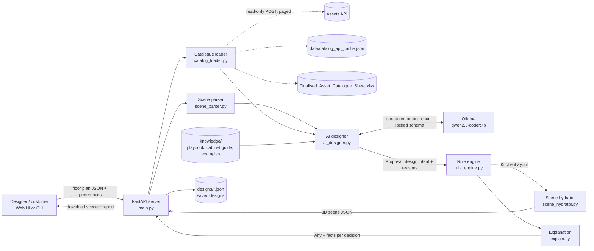
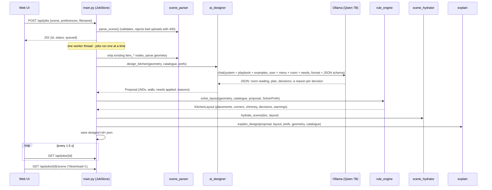

# MagickHome AI Kitchen Designer — System Architecture

This document describes how the kitchen generator is built: its components, how a design flows through them, the data
contracts between them, the design rules it enforces, and how it is configured, tested and run.

**In one sentence:** a floor plan (`magickhomes-scene` v1 JSON) goes in. A local Qwen model makes the *design decisions*
and explains them. A deterministic rule engine turns those decisions into an exact, collision-free cabinet layout. A
hydrator writes the layout back as a complete 3D scene JSON: cabinets, appliances, countertops and panels.

Everything runs **offline on a CPU laptop**. The only network call is an optional, read-only fetch of the cabinet
catalogue from the MagickHome Assets API, with a local cache and the Excel sheet as fallbacks.

---

## 1. Overview



| Layer | Module | Responsibility |
|---|---|---|
| Presentation | `static/index.html` | Single-page offline UI: upload, preferences and household needs, progress, plan and wall views, explanations, downloads |
| Service | `main.py` | FastAPI endpoints, background job queue, persistence of finished designs, CLI |
| Input | `scene_parser.py` | Reads the floor plan into wall frames, openings, corners and the room outline |
| Catalogue | `catalog_loader.py` | Loads about 3,700 SKUs (API → cache → xlsx), normalises them and filters by door style and tier |
| Design intent | `ai_designer.py` | Builds the prompt and schema, calls Qwen through Ollama, converts the answer into a `Proposal`; also holds the rule-based fallback designer |
| Knowledge | `design_knowledge.py`, `knowledge/` | Designer playbook, worked examples and per-category cabinet notes that teach Qwen through the prompt |
| Layout | `rule_engine.py` | Turns the proposal into exact placements and enforces every architectural and ergonomic rule |
| Output | `scene_hydrator.py` | Writes cabinets, appliances and procedural fixtures as `magickhomes-scene` nodes |
| Explainability | `explain.py` | For each decision: what was built, the designer's reason, measured facts and rule corrections |
| Quality | `test_pipeline.py`, `designer_benchmark.py` | Independent output verifier and test suite; a benchmark that scores Qwen's decisions |

**Division of labour, the key design principle.** The language model is good at *choices with reasons* and bad at
*geometry and arithmetic*. So Qwen states only design intent: which walls, which units, roughly where, and why.
The rule engine owns every millimetre and every hard rule. It corrects Qwen when Qwen breaks a rule and records
each correction. Customer-stated needs bypass Qwen entirely.

---

## 2. Request lifecycle



The pipeline function is `main.generate_kitchen(doc, prefs, progress)`. The UI, the synchronous API and the CLI all
use it, and it reports progress through these steps:

1. **Reading the floor plan:** strip `item_*` nodes, then `parse_scene`.
2. **Loading the cabinet catalogue:** `load_filtered_catalog(door_style, handle_type)`.
3. **Designing:** Qwen (`ai_mode = ollama/auto`) or the rule-based designer (`fallback`). `auto` falls back
   automatically when Ollama is unavailable.
4. **Applying design rules:** `solve_layout`. Base cabinet style = the customer's stated style, else the designer's choice.
5. **Building the 3D scene:** `hydrate_scene`.
6. **Report:** `validate_layout` issues, explanation, customer needs, timings.

---

## 3. Components

### 3.1 Web UI — `static/index.html`

A single self-contained HTML file with no build step and no external requests, served at `/`. The server sends
`Cache-Control: no-cache`, so a refresh always loads the current version.

- **Left column, three steps:**
  1. Floor plan: drag-and-drop, file picker, or the bundled sample room.
  2. Your kitchen:
     - designer: Qwen AI designer or Quick rules;
     - layout: best fit, one wall, L or U;
     - door style; tall storage and lofts;
     - **Household needs**: water purifier, gas supply, built-in oven/microwave, glass display, base cabinet
       style, cooking style, people at home;
     - a free-text brief with clickable ideas;
     - optional cabinet walls.
  3. Design.
  
  Need options default to **"Let Qwen decide"**, which reads "Standard choice" when Quick rules is selected.
- **Right column:**
  - **Result banner:** layout, cabinet count, rules status, design time, downloads.
  - **"Why these choices":** one row per decision with the built item, the designer's reason, the customer need,
    "Facts checked by the system" and amber "Rules:" corrections.
  - **Preview:** a top view plus a front view of each cabinet wall, as seen from inside the room.
  - **Design rules check** and the **cabinet list**, grouped by wall.
- **Drawing:** SVG plan and elevations are drawn from the *output scene* in MagickHome's wall frame (§4.1), so the
  preview matches what MagickHome will show.
- **Deep links:**
  - `?job=<id>` reopens a saved design;
  - `&tab=<wallId>` opens a wall view;
  - `?sample&run&ai=fallback` runs the sample automatically (used for screenshots).

### 3.2 API server and job queue — `main.py`

| Method and path | Purpose |
|---|---|
| `GET /` | Web UI |
| `GET /health` | Model name, Ollama status, expected design time, catalogue status |
| `GET /api/door-styles` | Door styles that have both sink and hob units |
| `GET /api/sample-floorplan` | The production sample with its kitchen items stripped |
| `POST /api/catalog/refresh` | Reload the catalogue (API → cache → xlsx) |
| `POST /api/generate-kitchen` | Synchronous generation; returns the scene, plus the report when asked |
| `POST /api/jobs` | Queue a generation (202); bad scenes are rejected immediately with 400 |
| `GET /api/jobs/{id}` | Status, stage, progress log, queue position, report |
| `GET /api/jobs/{id}/scene` | Generated scene JSON (`?download=1` adds an attachment filename) |
| `GET /api/jobs/{id}/report` | Design report JSON |

- **JobStore:**
  - one `ThreadPoolExecutor(max_workers=1)`: a CPU laptop serves one Qwen generation at a time, so other jobs queue;
  - keeps 25 jobs in memory;
  - writes every finished job (scene + report) to `designs/<id>.json`;
  - reloads a job lazily from disk, so links survive restarts.
- **Warm-up:** at start-up a background thread checks that the Ollama model is installed (and pulls it if allowed)
  and loads the catalogue.
- **Errors:** HTTP 400 for invalid scenes, 503 when the AI is required but unavailable, 422 when no layout is
  feasible, 500 otherwise.
- **CLI:** `python main.py --input plan.json --output kitchen.json [--report r.json] [--layout L] [--ai fallback] ...`
  or `--serve [--host --port]`.

### 3.3 Catalogue loader — `catalog_loader.py`

- **Sources, in order:**
  1. Assets API: `POST ?page=N&limit=1000` with body `{}`, read-only, paginated.
  2. The last good API response, `data/catalog_api_cache.json`.
  3. `Finalised_Asset_Catalogue_Sheet.xlsx`.

  The API record is kept on each item; its `modelUrl` and `thumbnail` are written into the scene.
- **Normalisation:** category keys are canonical (lower-case, dashes unified), and door styles match on letters and
  digits, so "Shaker 1" equals "Shaker -1". `'None'` strings become `None`.
- **`CatalogItem`:**
  - fields: `aid`, category, unit family, W×D×H, combination, door style, opening, handle, internals;
  - derived: `tier` (base/wall/tall/loft), `is_corner`, `floor_standing`.
- **`Catalog.filter/find/variant`:**
  - filtering by door style, handle and tier heights/depths (`TIER_HEIGHTS_MM`, `TIER_DEPTHS_MM`);
  - `variant()` finds the left/right-hinged twin of a single-shutter unit.
- **Corner handedness** (`corner_side_for`, derived from the GLB geometry):
  - L-shaped corner units (Wall L Corner, Loft L Corner, Base L corner) exist in **one hand only**, with the corner
    on the viewer's right;
  - blind corner "- L" has its door on the left and blind panel on the right; "- R" is the mirror image.

### 3.4 Scene parser — `scene_parser.py`

Produces `RoomGeometry`: walls, openings, corners, the room outline and the level id.

- **Wall frame:** local x runs start → end. Local +z is the wall's **front** side, `(-dz, dx)` in world x/z.
- **Which side is the room:** MagickHome's `frontSide` / `backSide` (`"interior"` / `"exterior"`) first. Without
  them, a point-in-polygon test against the slab or ceiling outline, which is correct for L-shaped and other
  non-convex rooms. The centroid is the last resort.
  - `Wall.front_interior` and `Wall.side_sign` (±1) record the result;
  - `side_of(end)` / `end_at(side)` convert between wall ends and the viewer's left/right.
- **Openings:** doors and windows with start/end/centre in mm, sill and head heights, and whether the door swings inward.
- **Corners:**
  - wall endpoints within 2 cm, 60–120° apart, that are **inside corners**, where each wall runs along the other's
    room side;
  - outside (reflex) corners of L-shaped rooms are not cabinet corners;
  - every joint trims the usable span by half the connecting wall's thickness (`inset_start/end_mm`).
- `wall_length_mm = round(hypot(dx, dz) * 1000)` and `wallT = center_mm / wall_length_mm`, as in the original spec.

### 3.5 AI designer — `ai_designer.py`

**Prompt versions** (`MAGICKHOME_PROMPT_VERSION`):

| | v1 (original) | v2 (default) |
|---|---|---|
| Teaching | 10 short rules | Knowledge pack: playbook, worked examples, a note on every option |
| Options | ~41 raw AIDs | ~36 readable codes (`SINK-900`, `HOB-900-3DRAWER`, `AQUAGUARD-600`, `MICROWAVE-600`) |
| Walls | ids | names ("Wall 1"), or `W1…` when names repeat |
| Room facts | lengths, openings, hint | plus corners, door-near-corner, free runs, hob centre range, U-shape aisle |
| Reasons | room reading + plan | plus a `*_why` **before every decision** (≤ 180 chars) |
| New units | — | water purifier, glass display, microwave / oven+micro / tall wicker towers |
| Customer needs | brief only | structured needs (enforced) + brief |

- **Shortlist** (`build_shortlist_v2`):
  - the designer-default option comes first in each group, because small models favour the first option;
  - base options are *feature* units only (drawers, wicker, grain trolley); the solver fills plain storage.
- **Hallucination guard:**
  - the response format is a JSON Schema built with Pydantic `create_model` and `Literal` enums of codes and wall
    names;
  - Ollama compiles it into a grammar, so the model can only emit valid options;
  - the reply is re-validated, with one retry that shows the validation error.
- **Schema field order:** reasoning first (`room_reading`, `design_plan`), then each `*_why` before its decision:
  1. layout and cabinet walls;
  2. sink;
  3. hob and its position;
  4. spice;
  5. LPG;
  6. tall units;
  7. purifier;
  8. display;
  9. base cabinet style (`drawers` / `mixed` / `shutters`);
  10. feature units;
  11. wall cabinet sizes.
- **Customer needs** (`KitchenPreferences`: `water_purifier`, `include_cylinder` = gas, `built_in`, `display_unit`,
  `base_storage`, `cooking`, `household_size`):
  - a **stated** need narrows the enum to that answer (`allowed_codes`, `allowed_storage`), so Qwen cannot override it;
  - **"auto"** means Qwen decides and must explain;
  - a brief that mentions *drawers* counts as a stated "drawers" need (`base_storage_need`);
  - `_ensure_built_in` adds a needed appliance tower if the model skipped it.
- **Ollama call:**
  - `temperature 0`, `seed 42`, `num_ctx 8192`, `num_predict 1500`;
  - `keep_alive 10m`; timeout 20 min;
  - `ensure_model()` checks the model and auto-pulls it if it is missing.
- **Outputs:** a `Proposal` (AIDs, wall ids, hob centre, tall units, feature units per wall, wall sizes, purifier,
  display, base storage, reasons) and an info dict (raw answer, timings, token counts).
- **Rule-based fallback designer** (`fallback_proposal`): rule-of-thumb choices that honour the same needs and
  provide reasons. Used for `ai_mode=fallback`, when Ollama is down in `auto`, and by most tests.

### 3.6 Knowledge pack — `design_knowledge.py`, `knowledge/`

The model weights are never trained. Qwen is taught through editable files:

| File | Content | Used as |
|---|---|---|
| `designer_playbook.md` | Read the room → zones (wet / cooking / storage) → work triangle → layout choice → sizes → customer needs → corners | system prompt |
| `worked_examples.md` | Three rooms (medium L, compact L, large U) with households, designer thinking and decisions | system prompt |
| `cabinet_guide.json` | All 40 catalogue categories: purpose, zone, when to choose, what to avoid, status; short notes per combination and width; `confirm` marks notes for MagickHome designers to check | a note next to each menu option |
| `CABINET_GUIDE.md` | Human-readable guide with sizes per door style (generated by `python design_knowledge.py`) | for designers |

The menu comes before the room in the user prompt, so Ollama can reuse the cached prompt prefix between designs.

### 3.7 Rule engine — `rule_engine.py`

Input: `Proposal` + `SolverPrefs` (loft, layout preference, forced walls, sink-under-window, base storage style).
Output: `KitchenLayout`, made of placements (item, wall, tier, start mm, role), corner plans, the chimney,
features (blocked spans per wall and zone), decisions and warnings.

**Algorithm:**

1. **Cabinet walls:**
   - validate the proposal's walls (≥ 1200 mm free run);
   - enforce the customer's layout or walls;
   - add the window wall so the sink can sit under the window.
2. **Static features:**
   - door clearance (+100 mm) on all tiers;
   - windows on the wall and loft tiers;
   - inward door-swing arcs projected onto adjacent walls.
3. **Search over corner assignments × sink sizes** (`_solve_walls` → `_plan_base`):
   - **Corners:** a blind corner unit on one wall (L or R by the viewer's side) and a 560 mm reserve on the other.
     If neither wall fits one, the corner is left **open**; a regular cabinet never goes in a corner.
   - **Sink:** centred on the window, trying the proposed size then the other widths. Any offset carries a heavy penalty.
   - **Tall units:** end-caps at run ends, never in front of a window. The proposed wall is preferred.
   - **Hob block** (`_search_block`), hob + spice (+ LPG):
     - chimney zone of 900 + 2×50 mm clear of windows and corners;
     - ≥ 600 mm from the sink on a shared wall;
     - ≥ 300 mm counter on its open side (heavily penalised if missing, not forbidden);
     - placed near the requested centre.
     
     Relaxation order: narrower hob or spice (900 → 800/750, 300 → 250/200/150), then drop LPG, then drop tall units.
   - **Fill:** every remaining gap is filled by **dynamic programming over the 50 mm module**, using the default
     SKU per width for the base storage style. Requested feature units are used when the rest still packs; units
     that don't fit move to the next wall (hob wall first) and are reported if they fit nowhere.
4. **Hard-rule retry:** if there is no hob, the sink is off the window, or there is no feasible layout, try other
   connected wall sets (same size first). Customer-named walls are never changed.
5. **Wall tier:**
   - corner tier first: Wall L Corner on the wall with the corner on the viewer's right, else a wall blind corner,
     else open;
   - then feature anchors: the **water purifier** beside the sink window, then its other sizes, then the next wall
     by the corner; the **glass display** at a run end;
   - then DP fill over the base coverage, keeping windows and the chimney clear.
6. **Loft** (optional, wall height ≥ 2.658 m): Loft L Corner above a Wall L Corner, deep lofts above tall units, then fill.
7. **Hinges:** single-shutter units hinge toward the nearest wall, door, corner or tall unit, judged from inside the room.
8. **Validate and repair:**
   - bounds, features, the per-tier corner rule, corner handedness, overlaps, world-space 3D SAT collisions,
     chimney and sink alignment;
   - removable roles are dropped one at a time until the layout is valid; everything is recorded in warnings.

### 3.8 Scene hydrator — `scene_hydrator.py`

- **Cabinets:**
  - `item` nodes parented to their wall; `asset.src` = the API `modelUrl`;
  - dimensions in metres, `offset [0, h/2, 0]`, asset scale 0.01 (the GLBs are in cm);
  - `placement` holds the level, `side`, `designSource`, and the corner orientation and end.
- **Appliances:**
  - `Sink90` (APS02) and `Hob90` (APH02) are children of their host cabinets;
  - `Chimney90` (APC02) hangs on the wall at y 1.44 m above the hob centre.
- **Procedural fixtures:**
  - toe-kicks; countertops with rounded sink and hob cut-outs and corner overhangs;
  - lower and upper backsplashes, cut around windows and wall cabinets;
  - end slabs and fillers for base, wall, tall and loft runs; loft top fillers;
  - an optional floor.
- **Determinism:** node ids come from a seed derived from the scene and preferences, so the same input gives the
  same output, apart from `exportedAt`.

### 3.9 Explanation — `explain.py`

For each decision — layout, sink, hob, spice, LPG, tall units, water purifier, glass display, base cabinets,
feature units, wall cabinets and corners — it returns:

| Field | Content |
|---|---|
| `built` | What is in the final kitchen |
| `decision` | What the designer first chose, when the rules changed it |
| `why` | The designer's own reason (Qwen's `*_why`, or the fallback's) |
| `details` | **Facts measured by the system**: wall lengths and free runs, window centre against sink centre, door distance, hob neighbours, chimney zone, sink-to-hob distance, sizes on offer, where each feature unit was built, what each wall keeps clear, corner units |
| `rules` | Rule-engine corrections relevant to the item |
| `source` | `customer` / `qwen` / `rules-designer` / `rules` |
| `need` | The customer's stated need |

Facts are computed, never written by the model, so they stay correct even when Qwen's reason is weak.

### 3.10 Designer benchmark — `designer_benchmark.py`

- **Rooms:** 8 test rooms built from the sample scene (compact, short window wall, door by the window corner,
  no window, large U, window near a corner, narrow galley).
- **Scoring:** each prompt version is scored on **14 designer checks of Qwen's own decisions**, before the solver
  corrects them, plus solver corrections, verification and time.
- **Output:** `benchmark/REPORT.md` and `benchmark/results_*.json`.

---

## 4. Data contracts and conventions

### 4.1 MagickHome wall frame

| Item | Rule |
|---|---|
| Wall-local axes | x = along the wall from `start` (metres); y = up; z = the wall's **front** side, `(-dz, dx)` |
| Room side | `frontSide == "interior"` → room at **+z**; `backSide == "interior"` → room at **−z** |
| Cabinet depth position | `z = side_sign × (thickness/2 + depth/2)`; e.g. 0.33 m (base/tall), 0.215 m (wall/loft), 0.375 m (650 corner) on 100 mm walls |
| Cabinet rotation | `[0, π, 0]` when the room is in front; `[0, 0, 0]` when it is behind (catalogue models face −z) |
| Heights (y) | base 0.10, floor-standing base (800 mm high) 0.00, tall 0.10, wall 1.44, loft 2.058 |
| `placement.side` | `+1` front, `−1` back (cabinets and fixtures) |
| Units | the solver works in **mm**; scene JSON is **metres** |

### 4.2 Corner models (from the GLB geometry)

| Model | Door / open side | Must sit where |
|---|---|---|
| Blind corner unit **– L** (base 1050–1250, wall 730/830) | door left, blind panel right | corner on the viewer's **right** |
| Blind corner unit **– R** | door right, blind panel left | corner on the viewer's **left** |
| Wall L Corner 650, Loft L Corner, Base L corner 960 | L-shape, one hand only | corner on the viewer's **right** |

"Viewer's right" is the wall's **end** for front-facing walls and its **start** for back-facing walls.

### 4.3 Report (`/api/jobs/{id}/report`)

- `ai`: mode, model, prompt version, timings, token counts, raw answer.
- `customer_needs`: the needs in plain words.
- `explanation`: §3.9.
- `proposal`: the design intent, with AIDs and reasons.
- `layout`:
  - cabinet walls; placements per wall (aid, category, tier, role, width, start/end, opening);
  - chimney; corners; loft walls; score;
  - decisions and warnings.
- `nodes_added`, `validation_issues`, `catalog` (source, filtered SKUs, door style), `seconds`.

---

## 5. Design rules enforced

| Rule | Where |
|---|---|
| Sink centred under the (widest) window, on the window wall | `_sink_target`, `_plan_base`, retry |
| ≥ 100 mm door clearance; inward door swings kept clear on adjacent walls | `_static_features` |
| Zero overlaps per tier; zero 3D collisions between walls; runs packed flush on the 50 mm module, fillers ≤ 150 mm | `fill_gap`, `validate_layout` |
| Corners take only corner cabinets, correctly handed, or stay open | `_plan_base`, `_place_corner_tier`, `validate_layout` |
| Hob on a legal spot: chimney zone clear of windows and corners, ≥ 600 mm from a sink on the same wall; ≥ 300 mm counter beside it strongly preferred | `_search_block` |
| Spice pull-out directly beside the hob | hob block |
| Tall units at run ends, never in front of windows | `_tall_slot` |
| No wall cabinets over windows or in the chimney zone | wall-tier features |
| Lofts only where the wall height allows (≥ 2.658 m) | `_plan_loft` |
| Height by ceiling: with lofts, 600 wall / 1940 tall units; without, the tallest pair (900/2240, 700/2040, 600/1940) whose top stays 50 mm under the ceiling; wall and tall tops always level. Designer picks are swapped for the same cabinet at the planned height | `height_plan`, `solve_layout`, `Catalog.at_heights` |
| Open shelf unit and glass display at run ends, away from the chimney | `_place_wall_features` |
| Lift-up wall doors where the catalogue has that width; other widths keep hinged doors | wall pool (`LIFT_UP_COMBOS`) |
| Single-shutter hinges toward the obstacle | `_apply_hinges` |
| Every kitchen has a hob; impossible wall sets are replaced | `solve` retry |

---

## 6. Who decides what

| Decision | Customer states it | Left to the designer | Rules can change it |
|---|---|---|---|
| Layout and cabinet walls | layout or wall picker | Qwen | yes: too short, missing window wall, no legal hob, corner window |
| Sink size and wall | — | Qwen | position always; size if it can't centre |
| Hob unit and position | — | Qwen | snapped to a legal spot, narrowed, or moved to another wall |
| LPG cylinder unit | gas: LPG / piped | Qwen | dropped if there's no room |
| Built-in oven / microwave towers | appliance need | Qwen | placed at a run end, dropped if it blocks the hob |
| Crockery unit (tall glass unit) | yes / no | Qwen | placed like other tall units |
| Lofts | yes / no | Qwen (default in the rules designer: yes when the ceiling allows) | never built under a 2.658 m ceiling |
| Wall cabinet doors (hinged / lift-up) | shutters / lift-up | Qwen | lift-up only in the widths the catalogue has |
| Open shelf unit | yes / no | Qwen | skipped if no run end fits |
| Wall / tall unit heights | — | — | always the rules (height by ceiling) |
| Water purifier (Aquaguard) | needed / not needed | Qwen | placed near the sink or the next wall; reported if impossible |
| Glass display | yes / no | Qwen | skipped if no run end fits |
| Base cabinet style | drawers / mixed / shutters, or "drawers" in the brief | Qwen | — |
| Feature units, wall cabinet sizes | — | Qwen | used where they pack; moved to another wall or reported |
| Corners, fillers, hinges, fixtures, appliances | — | — | always the rules |

---

## 7. Configuration (`config.py`, environment variables)

| Variable | Default | Meaning |
|---|---|---|
| `OLLAMA_HOST` | `http://127.0.0.1:11434` | Ollama server; can be a remote GPU, e.g. the Colab tunnel URL (see `colab/README.md`) |
| `OLLAMA_API_KEY` | — | Password sent as `Authorization: Bearer …` to a remote Ollama behind `colab/ollama_auth_proxy.py` |
| `OLLAMA_MODEL` | `qwen2.5-coder:7b` | Designer model (Apache 2.0). `qwen2.5-coder:3b` is faster but research-licensed |
| `OLLAMA_TIMEOUT_S` | 1200 | Per-request timeout |
| `OLLAMA_AUTO_PULL` | 1 | Pull the model on first use |
| `AI_EXPECTED_TIME` | "4-5 minutes" (7B) | Shown in the UI |
| `MAGICKHOME_PROMPT_VERSION` | `v2` | `v1` = original prompt, for A/B tests |
| `MAGICKHOME_AI_PROVIDER` | `qwen` | Default designer: `qwen` (Ollama) or `gemini` (Google API); a request can override it with `preferences.ai_provider` |
| `GEMINI_API_KEY` | — | Enables Gemini. Read from the environment only; never written to files or reports |
| `GEMINI_MODEL` | `gemini-flash-latest` | Gemini model used by `gemini_designer.py` |
| `GEMINI_USE_KNOWLEDGE` | `0` | `0` = Gemini designs from its own judgement (plain room facts, cabinet list, needs, answer format; no playbook, examples, cabinet notes or rule hints). `1` = same prompt as Qwen |
| `MAGICKHOME_KNOWLEDGE_DIR` | `knowledge/` | Knowledge pack location |
| `MAGICKHOME_JOBS_DIR` | `designs/` | Saved designs |
| `MAGICKHOME_ASSETS_API_URL` | Assets API cabinets endpoint | `""` disables the API (cache / xlsx only) |
| `MAGICKHOME_ASSETS_API_PAGE_SIZE` | 1000 | Page size for the read-only catalogue fetch |
| `CATALOG_XLSX_PATH` | `Finalised_Asset_Catalogue_Sheet.xlsx` | Offline catalogue |

Fixed engineering constants (clearances, tier heights and depths, fixture geometry) live in `config.py` with comments.

---

## 8. Repository layout

```
qwen2.5/
├── main.py                 FastAPI app, job queue, CLI
├── ai_designer.py          Qwen prompt/schema/call, customer needs, fallback designer
├── rule_engine.py          Layout solver and validator
├── scene_parser.py         Floor plan → RoomGeometry
├── scene_hydrator.py       KitchenLayout → magickhomes-scene nodes
├── catalog_loader.py       Catalogue sources, normalisation, filtering, corner handedness
├── explain.py              Per-decision explanations and facts
├── design_knowledge.py     Loads the knowledge pack; generates CABINET_GUIDE.md
├── designer_benchmark.py   Scores Qwen's decisions on 8 rooms
├── extract_presets.py      Harvests material presets from reference scenes
├── config.py               All settings
├── test_pipeline.py        Test suite + independent scene verifier
├── requirements.txt
├── static/index.html       Web UI
├── knowledge/              Playbook, worked examples, cabinet guide (+ README)
├── data/                   material_presets.json, catalog_api_cache.json
├── designs/                Saved designs from the web UI (<id>.json)
├── test_data/              Real non-rectangular floor plans used by the tests
├── test_output/            Scenes and reports written by the tests
├── benchmark/              Benchmark reports
├── docs/ARCHITECTURE.md    This document
├── Finalised_Asset_Catalogue_Sheet.xlsx
└── magickhomes-scene_*.json   Reference scenes from MagickHome designers
```

---

## 9. Verification and testing

- **Independent verifier** (`test_pipeline.verify_scene`). It reads only the output JSON and the xlsx and never
  reuses solver internals. It checks:
  - schema and node graph;
  - AIDs present in the catalogue sheet; `asset.src` equals the API `modelUrl`;
  - y, z and rotation per tier and wall side; `wallT`;
  - **every cabinet inside the room outline**;
  - sink centred under the window, with Sink90;
  - hob with Hob90 and Chimney90; chimney zone clear; spice beside the hob;
  - door clearance; nothing in front of windows;
  - world-space 3D SAT collisions;
  - the per-tier corner rule at inside corners, and corner-model handedness;
  - fixtures present.
- **Test suite** (`python -m pytest test_pipeline.py -q`): 41 cases covering:
  - scenarios (auto, reference L, Shaker U, single wall), lofts, rotated room;
  - corner fallbacks;
  - real L-shaped and 8-wall rooms, including a reversed wall;
  - the verifier catching broken scenes (mutation tests);
  - the Assets API loader (mocked); web job flow and persistence; determinism;
  - mocked-Qwen v1/v2 paths and schema guards;
  - enforced customer needs, explanations, drawers, feature-unit spill-over, needed purifier;
  - knowledge pack coverage of the catalogue.

  Live-model runs: `python test_pipeline.py --ai-mode ollama`.
- **Regression sweep:** 8 benchmark rooms × 4 layouts × 2 door styles = 64 kitchens, all verified.
- **Benchmark:** `python designer_benchmark.py --versions v2 v1` measures design quality and speed per prompt version.

---

## 10. Running

```bash
pip install -r requirements.txt
ollama pull qwen2.5-coder:7b          # ~4.7 GB, Apache 2.0
python main.py --serve                # http://127.0.0.1:8000
# or headless:
python main.py --input plan.json --output kitchen.json --report report.json --ai auto
```

| Hardware (tested) | Intel i5-1245U, 16 GB RAM, no GPU |
|---|---|
| Qwen 7B | ~5.5 GB RAM; first design after loading ~8 min, then ~3.5–5 min |
| Quick rules designer | under a few seconds |
| Memory tip | close browsers while Qwen runs; the 7B needs ~5–5.5 GB free |

---

## 11. Licensing and data constraints

- **Qwen2.5-Coder 7B:** Apache 2.0, confirmed with `ollama show --license`. Commercial use is allowed; keep the
  licence notice if the weights are redistributed.
- **Qwen2.5-Coder 3B:** Qwen Research License, non-commercial. Kept only for comparison.
- **Assets API:** read-only use. The generator never writes to the catalogue.
- **Training:** fine-tuning on designs generated with Anthropic's Claude needs Anthropic's prior written authorization.
  The preferred training data is MagickHome designers' own finished projects.

---

## 12. Known limitations and roadmap

- **Qwen's reasoning is imperfect.** It sometimes misreads which wall has the door, writes reasons that contradict
  its choice, or copies phrases. The rules and the measured facts catch and expose this.
- **Free-text briefs** are only partly understood. Only "drawers" is read as a fixed need. Planned: rule-based
  reading of "piped gas", "RO", "water filter", "microwave", "bake" and "family of N".
- **Not modelled yet:** fridge space, Vastu orientation, budget tiers, ergonomics for elderly users, and corner sink
  or corner cylinder units (the catalogue has them).
- **Planned:** a design → self-review pass; multiple concepts per room; replacing the worked examples with
  MagickHome's real projects; later, LoRA fine-tuning on a borrowed GPU and running the result locally through Ollama.
